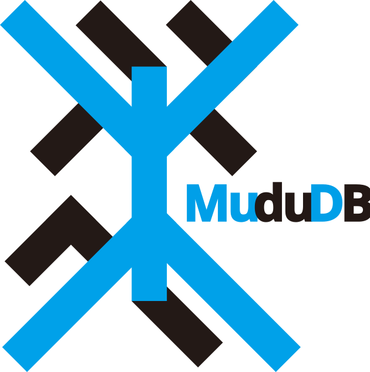
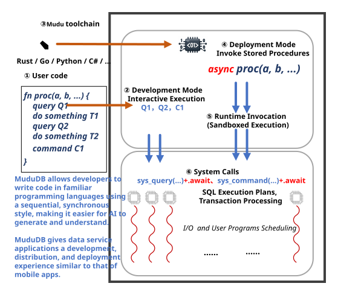

# MuduDB


[](doc/en/name.md)

[汉语](README.zh-CN.md)

---

MuduDB is an open-source relational database with a built-in application runtime.

Build data-centric, real-time applications in C, C#, Go, AssemblyScript, Python, or Rust, package them as MuduDB Apps, and deploy them directly into the database. 

Your application logic runs right next to the data, reducing data movement, simplifying system architecture, and enabling low-latency execution.

Application Server + Database. All in One. 

Run your application where your data lives.

## Start here

| Your task | Reading path |
|---|---|
| Install tools and run an example | [Environment setup](doc/en/how_to_start.md) → [Your first MPK](doc/en/your_first_mpk.md) |
| Write or call a procedure | [Core concepts](doc/en/concepts.md) → [Procedure development](doc/en/procedure.md) |
| Choose or publish an SDK | [Languages and execution modes](doc/en/sdk_distribution.md#language-and-execution-modes) · [Manual publishing](doc/en/sdk_distribution.md#manual-github-action) |
| Change the database implementation | [Code architecture](ARCHITECTURE.md) · [Contributor conventions](AGENTS.md) |
| Verify buffer correctness | [Aeneas + Lean: install, verify and troubleshoot](verification/README.md) |

## Execution model

Procedures compile to WebAssembly components and are packaged with their DDL (data definition language — the schema the procedures run against), initial data and descriptors in an `.mpk` (MuduDB package) archive. Clients invoke the procedures after installing the package in `mudud`.

Native applications can instead run as local applications by explicitly selecting the separately distributed adapter runtime; each language's entry point for this mode is listed under [Languages and execution modes](doc/en/sdk_distribution.md#language-and-execution-modes).

Rust procedures use the `Entity` trait to map query results to structs. The build's `mgen check-sql` step checks SQL against DDL, while the language compiler checks types. Neither replaces runtime tests.

## Architecture



The kernel owns storage, transactions, query execution and scheduling. The runtime loads and executes WebAssembly components. Procedures access the kernel through system calls, with transaction and scheduling decisions made by the kernel.

The runtime uses per-core workers and a Linux I/O path based on `io_uring`. See [runtime design](doc/en/modern_hardware.md) for the tradeoffs and the table below for the source layout.

## Project Structure

The repository is organized as independent Cargo workspaces under `crates/`, connected by path dependencies. All workspaces share a single `target/` directory at the repository root (configured in `.cargo/config.toml`).

| Directory | Contents |
|-----------|----------|
| `crates/common` | Foundation and shared libraries: `mudu` (core types/errors), `mudu_sys*` (OS/async abstraction), `mudu_type`, `mudu_binding`, `mudu_contract` (wire protocol), `mudu_caf` (CAF container codec), `sql_parser`, `sys_interface`, `mudu_client` (TCP/JSON client), and utilities. |
| `crates/db-kernel` | The database itself: `mudu_kernel` (facade re-exporting the sixteen engine crates — `catalog`/`index`/`page_buffer`/`wal`/`xengine`/`storage`/`meta`/`command`/`sql`/`conn`/`xcontract`/`worker`/`repl`/`backup`/`server`/`ws_gateway`), `mudu_runtime` (pgwire/HTTP serving backend), `runtime_wasm` (WASM procedure host), `runtime_libsql` (libsql connector), `mudud` (server daemon), `mudu_adapter` (storage adapters), `mudu_raft` (Raft consensus), `sys_interface_standalone`, `testing` (integration tests), `catalog-testing` (catalog test fixtures). |
| `crates/sdk` | App development kit: `mududb` (app-facing facade), `mudu_api_sync` (synchronous API), language bindings (`bindings/`, `mudu_api/`). |
| `example/mpk` | Guest-SDK example apps (`wallet`, `tpcc`, `ycsb`, ...) in their own workspace. |
| `crates/tools` | Developer toolchain: `mudu_cli` (the `mcli` CLI client), `mudu_gen` (the `mgen` code generator), `mudu_transpiler` (the `mtp` transpiler), `mpm_build` / `mpm_crate` / `mpm_install` / `mpm_tool` (the `mpm-build` / `mpm-crate` / `mpm-install` / `mpm-tool` MPK packaging tools). |

Dependency direction is strictly one-way: `common` ← `db-kernel` ← `sdk`, with `tools` a peer of `sdk` that may depend on `common` and `db-kernel` (for example `mudu_cli` uses `backup`).

Build or check one workspace at a time from its directory:

```bash
cd crates/db-kernel && cargo build --release
```

`script/ci/check_all.py` (`cargo make check`) runs `cargo fmt --check`, `cargo clippy --workspace --all-targets -- -D warnings`, and `cargo test --no-run --workspace` across all workspaces sequentially.

## Documentation

- [Documentation index](doc/README.md)
- [How to start](doc/en/how_to_start.md)
- [Core concepts](doc/en/concepts.md)
- [Your first MPK tutorial](doc/en/your_first_mpk.md)
- [Deployment guide](doc/en/DEPLOY.md)

## License

MuduDB is licensed under the [Apache License 2.0](LICENSE).
