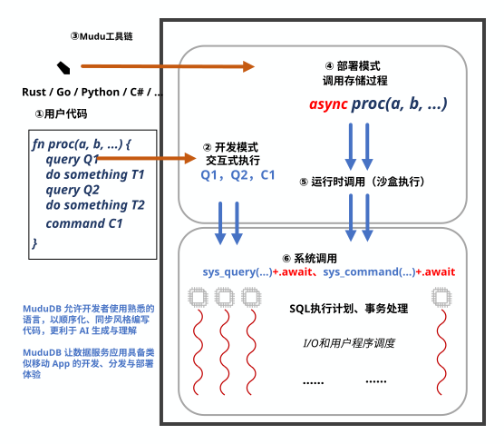

# MuduDB


[](doc/zh-CN/name.zh-CN.md)

[English](README.md)

---

MuduDB 是一个内置应用运行时的开源关系型数据库。

使用 C, C#, Go, AssemblyScript, Python 或 Rust 构建以数据为中心的实时应用，打包成 MuduDB 应用，直接部署到数据库中。

你的应用逻辑紧贴数据运行，减少数据搬运、简化系统架构，并实现低延迟执行。

应用服务器 + 数据库，合二为一。

让应用运行在数据所在的地方。

## 从这里开始

| 你想做什么 | 阅读入口 |
|---|---|
| 安装工具并运行第一个示例 | [环境配置](doc/zh-CN/how_to_start.zh-CN.md) → [第一个 MPK](doc/zh-CN/your_first_mpk.zh-CN.md) |
| 编写或调用过程 | [核心概念](doc/zh-CN/concepts.zh-CN.md) → [过程开发](doc/zh-CN/procedure.zh-CN.md) |
| 选择语言 SDK 或发布 SDK | [语言与运行方式](doc/en/sdk_distribution.md#language-and-execution-modes) · [发布指南](doc/zh-CN/sdk_publish_github_actions.zh-CN.md) |
| 修改数据库实现 | [代码架构](ARCHITECTURE.md) · [开发约定](AGENTS.md) |
| 验证缓冲区正确性 | [Aeneas + Lean：安装、验证与排错](verification/README.zh-CN.md) |

## 执行方式

过程编译为 WebAssembly 组件，再与 DDL（数据定义语言，即过程所操作的表结构）、初始数据和描述符打包成 `.mpk`（MuduDB 软件包）。将软件包安装到 `mudud` 后，客户端即可调用其中的过程。

原生应用也可以显式选择独立分发的 adapter runtime，以本地应用的方式运行；该模式下各语言的入口见[语言与运行方式](doc/en/sdk_distribution.md#language-and-execution-modes)。

Rust 过程通过 `Entity` trait 将查询结果映射为结构体。构建步骤中的 `mgen check-sql` 对照 DDL 检查 SQL；语言编译器负责类型检查，两者都不能代替运行时测试。

## 架构



内核负责存储、事务、查询执行和调度，运行时负责加载和执行 WebAssembly 组件。过程通过系统调用访问内核，由内核统一管理事务与调度。

运行时采用按核 worker 模型，Linux I/O 路径使用 `io_uring`。设计取舍见[运行时架构](doc/zh-CN/modern_hardware.zh-CN.md)，源码组织见下表。

## 项目结构

仓库按 `crates/` 下的多个独立 Cargo workspace 组织，workspace 之间通过 path 依赖连接。所有 workspace 共享仓库根目录下的同一个 `target/` 目录（在 `.cargo/config.toml` 中配置）。

| 目录 | 内容 |
|------|------|
| `crates/common` | 基础与共享库：`mudu`（核心类型/错误码）、`mudu_sys*`（操作系统/异步抽象）、`mudu_type`、`mudu_binding`、`mudu_contract`（线协议）、`mudu_caf`（CAF 容器编解码）、`sql_parser`、`sys_interface`、`mudu_client`（TCP/JSON 客户端）以及各类工具库。 |
| `crates/db-kernel` | 数据库本体：`mudu_kernel`（facade，重导出 16 个引擎 crate —— `catalog`/`index`/`page_buffer`/`wal`/`xengine`/`storage`/`meta`/`command`/`sql`/`conn`/`xcontract`/`worker`/`repl`/`backup`/`server`/`ws_gateway`）、`mudu_runtime`（pgwire/HTTP 服务后端）、`runtime_wasm`（WASM 过程宿主）、`runtime_libsql`（libsql 连接器）、`mudud`（服务器守护进程）、`mudu_adapter`（存储适配器）、`mudu_raft`（Raft 共识）、`sys_interface_standalone`、`testing`（集成测试）、`catalog-testing`（catalog 测试夹具）。 |
| `crates/sdk` | 应用开发套件：`mududb`（面向应用的 facade）、`mudu_api_sync`（同步 API）、语言绑定（`bindings/`、`mudu_api/`）。 |
| `example/mpk` | 客端 SDK 示例应用（`wallet`、`tpcc`、`ycsb` 等），独立 workspace。 |
| `crates/tools` | 开发者工具链：`mudu_cli`（`mcli` 命令行客户端）、`mudu_gen`（`mgen` 代码生成器）、`mudu_transpiler`（`mtp` 转译器）、`mpm_build` / `mpm_crate` / `mpm_install` / `mpm_tool`（`mpm-build` / `mpm-crate` / `mpm-install` / `mpm-tool` MPK 打包工具）。 |

依赖方向严格单向：`common` ← `db-kernel` ← `sdk`，`tools` 是 `sdk` 的平级，可依赖 `common` 与 `db-kernel`（例如 `mudu_cli` 使用了 `backup`）。

构建或检查某个 workspace 时，进入对应目录执行：

```bash
cd crates/db-kernel && cargo build --release
```

`script/ci/check_all.py`（`cargo make check`）会依次对所有 workspace 执行 `cargo fmt --check`、`cargo clippy --workspace --all-targets -- -D warnings` 和 `cargo test --no-run --workspace`。

## 文档导航

- [文档索引](doc/README.md)
- [如何开始](doc/zh-CN/how_to_start.zh-CN.md)
- [核心概念](doc/zh-CN/concepts.zh-CN.md)
- [第一个 MPK 教程](doc/zh-CN/your_first_mpk.zh-CN.md)
- [部署指南](doc/zh-CN/DEPLOY.md)

## 许可证

MuduDB 采用 [Apache License 2.0](LICENSE) 许可证。
