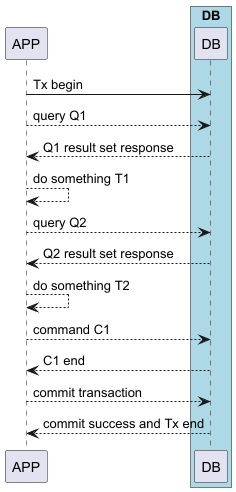
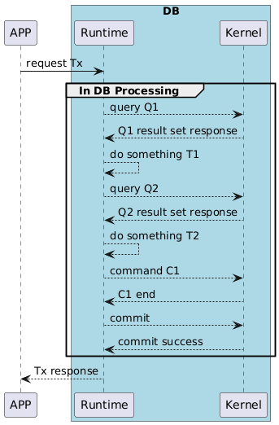

# Mudu Procedure 规范与开发指南

## 背景

交互式与过程式是构建数据库应用的两种不同方式。

采用交互式方式时，用户通过命令行工具、GUI 工具、客户端库或 ORM 框架直接执行 SQL 语句。这种方式反馈即时、
适合快速原型与调试、几乎不需要额外配置、对初学者友好；代价是数据库客户端与服务器之间存在通信开销，
事务语义也更容易出错。

采用过程式方式时，开发者使用存储过程、函数和触发器实现业务逻辑。这种方式减少网络开销、集中管理业务逻辑、
更容易满足 ACID 要求、并能降低 SQL 注入风险；代价是需要掌握数据库特定的过程式语言、调试更困难、
在不同 DBMS 之间的可移植性较差（厂商锁定），且版本控制通常需要专门工具。

## Mudu Procedure（MP）：统一交互式与过程式执行

MP 的目标是结合这两种方式的优势，同时避免它们常见的缺点。同一份代码既可以在交互式模式下运行，也可以在
过程式模式下运行。你可以使用大多数现代编程语言来编写 Mudu Procedure，而不必依赖 PostgreSQL PL/pgSQL 或
MySQL 存储过程这类数据库特有的过程式语法。在开发阶段，Mudu Procedure 的运行方式更接近基于 ORM 框架的
交互式开发体验。

### Guest 语言

Mudu Procedure 会被编译为 WASM 组件，运行时目前支持六种 Guest 语言：Rust、AssemblyScript、C#、Python、C 和
Go。本指南以 Rust facade 为例，它是过程 API 的参考实现；其余语言参见
[绑定 API 表面](../dev/binding_api_surface.md)和 [SDK 构建与语言支持](../dev/sdk_distribution.md)。

基于 Rust 的过程使用如下函数签名：

### 过程规范

```text
/**mudu-proc**/
fn {procedure_name}(
    oid: OID,
    {argument_list...}
) -> RS<{return_value_type}>
```

#### 过程名称：

一个合法的 Rust 函数名。

#### 标记 `/**mudu-proc**/`：

用于将紧随其后的函数标记为 Mudu Procedure，供 transpiler 生成过程包装代码。

#### 参数：

##### oid：

传入过程的当前系统会话 ID。

#### {argument_list...}：

输入参数需要能够被 Mudu 当前的 `datum / tuple` 转换体系表示。

常见可用形式包括标量类型，如 `i32`、`i64`、`String`、`f32`、`f64`，以及当前示例中已经使用到的
`Vec<String>` 等容器形式。

精确支持范围以当前 [`mudu_type` 转换体系](../../crates/common/mudu_type/src/datum.rs)和 transpiler
实现为准，而不是本文中的一个固定短名单。

#### 返回值：

##### {return_value_type}：

返回值同样需要能够被 Mudu 当前的 `datum / tuple` 转换体系表示。
当前实现中，这包括标量值、tuple 返回值以及 `Vec<T>` 形式的结果容器。

结果类型别名 `RS` 定义如下：

```rust
use mudu::error::err::MError;
pub type RS<X> = Result<X, MError>;
```

在过程内部，运行时可以调用[系统调用](syscall.cn.md)，例如 SQL 系统调用（`mudu_query` / `mudu_command` / `mudu_batch`）或键值系统调用（`mudu_get` / `mudu_put` / `mudu_range`）。

### Mudu Procedure 中的 CRUD（Create/Read/Update/Delete）操作

Mudu Procedure 可以调用两个核心 API。
在稳定调用面上，手写同步过程代码应使用 `sys_interface::sync_api`，生成的异步过程代码应使用
`sys_interface::async_api`。

#### 1. `query`

`query` 用于 `SELECT` 语句。

<!--
quote_begin
content="[Query API](../lang.common/mudu_query.md#L-L)"
-->
```rust
use sys_interface::sync_api::mudu_query;
use sys_interface::async_api::mudu_query as mudu_query_async;

pub fn mudu_query<R: Entity>(
    oid: OID,
    sql: &dyn SQLStmt,
    params: &dyn SQLParams,
) -> RS<EntitySet<R>> {
    /* ... */
}

pub async fn mudu_query_async<R: Entity>(
    oid: OID,
    sql: &dyn SQLStmt,
    params: &dyn SQLParams,
) -> RS<EntitySet<R>> {
    /* ... */
}
```

<!--quote_end-->

`query` 会自动执行 R2O（relation-to-object，关系到对象）映射，并返回一个由实现 `Entity` trait 的对象组成的结果集。

#### 2. `command`

`command` 用于 `INSERT`、`UPDATE` 和 `DELETE` 语句。

<!--
quote_begin
content="[Command API](../lang.common/mudu_command.md#L-L)"
-->
```rust
use sys_interface::sync_api::mudu_command;
use sys_interface::async_api::mudu_command as mudu_command_async;

pub fn mudu_command(
    oid: OID,
    sql: &dyn SQLStmt,
    params: &dyn SQLParams,
) -> RS<u64> {
    /* ... */
}

pub async fn mudu_command_async(
    oid: OID,
    sql: &dyn SQLStmt,
    params: &dyn SQLParams,
) -> RS<u64> {
    /* ... */
}
```

<!--quote_end-->

#### 3. `batch`

`batch` 是 `command` 的 SQL 批量变体。它保持相同的 API 形态与返回结构，但用于通过
`libsql::execute_batch` 执行原始批量 SQL 文本。

<!--
quote_begin
content="[Batch API](../lang.common/mudu_batch.md#L-L)"
-->
```rust
use sys_interface::sync_api::mudu_batch;
use sys_interface::async_api::mudu_batch as mudu_batch_async;

pub fn mudu_batch(
    oid: OID,
    sql: &dyn SQLStmt,
    params: &dyn SQLParams,
) -> RS<u64> {
    /* ... */
}

pub async fn mudu_batch_async(
    oid: OID,
    sql: &dyn SQLStmt,
    params: &dyn SQLParams,
) -> RS<u64> {
    /* ... */
}
```
<!--quote_end-->

#### 两者通用参数

##### oid：

传入过程的当前系统会话标识。

##### sql：

使用 `?` 作为参数占位符的 SQL 语句。

##### params：

参数列表。
对于 `batch`，当前 libsql 实现要求参数列表为空。

#### 生成的实体绑定（`mgen entity`）

对于 `sql/ddl.sql` 中的每张表，`mgen entity` 生成一个 Rust 模块，包含：

- 实现 `Entity` trait 的行结构体（如 `Wallets`），以及 `TABLE_NAME` 与 `columns::*` 列名常量；
- 针对含主键表的预构建 SQL 文本常量 `SQL_GET_BY_PK`、`SQL_INSERT`、`SQL_DELETE_BY_PK`，以及返回
  `SQL_INSERT` 类型化绑定元组的 `insert_params()`；
- 部分更新变更集 `<Table>Change`，每个非键列对应一个 `FieldChange<T>`：`Unchanged`（默认）不更新该列，
  `Set(v)` 更新该列；对于可空列，`Set(None)` 写入 SQL `NULL`。

`update_by_pk(...)` 构造 `UPDATE ... SET ... WHERE <pk> = ?` 语句及其绑定参数；当没有任何列被标记时
返回 `None`：

```rust
let change = WalletsChange {
    balance: FieldChange::Set(Some(200)),
    ..WalletsChange::default()
};
if let Some((sql, params)) = change.update_by_pk(user_id) {
    mudu_command(oid, sql_stmt!(&sql), sql_params!(&params))?;
}
```

过程源码中的 SQL 字面量可以在构建期通过 `mgen check-sql` 对照 DDL 进行静态检查，
参见 [`../dev/sql_subset.md`](../dev/sql_subset.md)。


<!--
quote_begin
content="[KeyTrait](../lang.common/proc_key_traits.md#L-L)"
-->

## 关键 trait

### SQLStmt

<!--
quote_begin
content="[Entity](../../crates/common/mudu_contract/src/database/entity.rs#L23-L44)"
lang="rust"
-->

```rust
pub trait Entity: Datum {
    fn tuple_desc() -> &'static TupleFieldDesc;

    fn table_name() -> &'static str;

    fn from_tuple(row: &TupleField) -> RS<Self>;

    fn from_tuple_value(row: &TupleValue) -> RS<Self>;

    fn to_tuple(&self) -> RS<TupleField>;

    fn to_tuple_value(&self) -> RS<TupleValue>;
}
```

<!--quote_end-->


<!--
quote_begin
content="[SQLStmt](../../crates/common/mudu_contract/src/database/sql_stmt.rs#L6-L10)"
lang="rust"
-->

```rust
pub trait SQLStmt: fmt::Debug + fmt::Display + Sync + Send {
    fn to_sql_string(&self) -> String;

    fn clone_boxed(&self) -> Box<dyn SQLStmt>;
}
```

<!--quote_end-->

### Datum、DatumDyn

<!--
quote_begin
content="[DatumDyn](../../crates/common/mudu_type/src/datum.rs#L20-L40)"
lang="rust"
-->

```rust
pub trait Datum: DatumDyn + Clone + 'static {
    fn data_type() -> DataType;

    fn from_binary(binary: &[u8]) -> RS<Self>;

    fn from_value(value: &DataValue) -> RS<Self>;

    fn from_textual(textual: &str) -> RS<Self>;
}

pub trait DatumDyn: fmt::Debug + Send + Sync + Any {
    fn type_family(&self) -> RS<TypeFamily>;

    fn to_binary(&self, data_type: &DataType) -> RS<DataBinary>;

    fn to_textual(&self, data_type: &DataType) -> RS<DataTextual>;

    fn to_value(&self, data_type: &DataType) -> RS<DataValue>;

    fn clone_boxed(&self) -> Box<dyn DatumDyn>;
}
```

<!--quote_end-->
<!--quote_end-->

### 示例：钱包应用中的转账过程

<!--
quote_begin
content="[Example](../lang.common/transfer_funds.md#L-L)"
-->
<!--
quote_begin
content="[Transfer](../../example/mpk/wallet/src/rust/procedures.rs#L23-L104)"
lang="rust"
-->
```rust
/**mudu-proc**/
pub fn transfer_funds(oid: OID, from_user_id: i32, to_user_id: i32, amount: i32) -> RS<()> {
    // Check amount > 0
    if amount <= 0 {
        return Err(mudu_error!(
            MuduError,
            "The transfer amount must be greater than 0"
        ));
    }

    // Cannot transfer money to oneself
    if from_user_id == to_user_id {
        return Err(mudu_error!(MuduError, "Cannot transfer money to oneself"));
    }

    // Check whether the transfer-out account exists and has sufficient balance
    let wallet_rs = mudu_query::<Wallets>(
        oid,
        sql_stmt!(&"SELECT user_id, balance FROM wallets WHERE user_id = ?;"),
        sql_params!(&from_user_id),
    )?;

    let from_wallet = if let Some(row) = wallet_rs.next_record()? {
        row
    } else {
        return Err(mudu_error!(MuduError, "no such user"));
    };

    if *from_wallet.get_balance().as_ref().unwrap() < amount {
        return Err(mudu_error!(MuduError, "insufficient funds"));
    }

    // Check the user account existing
    let to_wallet = mudu_query::<Wallets>(
        oid,
        sql_stmt!(&"SELECT user_id FROM wallets WHERE user_id = ?;"),
        sql_params!(&(to_user_id)),
    )?;
    let _to_wallet = if let Some(row) = to_wallet.next_record()? {
        row
    } else {
        return Err(mudu_error!(MuduError, "no such user"));
    };

    // Perform a transfer operation
    // 1. Deduct the balance of the account transferred out
    let deduct_updated_rows = mudu_command(
        oid,
        sql_stmt!(&"UPDATE wallets SET balance = balance - ? WHERE user_id = ?;"),
        sql_params!(&(amount, from_user_id)),
    )?;
    if deduct_updated_rows != 1 {
        return Err(mudu_error!(MuduError, "transfer fund failed"));
    }
    // 2. Increase the balance of the transfer-in account
    let increase_updated_rows = mudu_command(
        oid,
        sql_stmt!(&"UPDATE wallets SET balance = balance + ? WHERE user_id = ?;"),
        sql_params!(&(amount, to_user_id)),
    )?;
    if increase_updated_rows != 1 {
        return Err(mudu_error!(MuduError, "transfer fund failed"));
    }

    // 3. Entity the transaction
    let id = Uuid::new_v4().to_string();
    let insert_rows = mudu_command(
        oid,
        sql_stmt!(
            &r#"
        INSERT INTO transactions
        (trans_id, from_user, to_user, amount)
        VALUES (?, ?, ?, ?);
        "#
        ),
        sql_params!(&(id, from_user_id, to_user_id, amount)),
    )?;
    if insert_rows != 1 {
        return Err(mudu_error!(MuduError, "transfer fund failed"));
    }
    Ok(())
}
```
<!--quote_end-->
<!--quote_end-->

### MP 与事务

Mudu Procedure 支持两种事务执行模式：

#### 自动模式

每个过程都作为一个独立事务运行。该事务会：

- 在过程返回 `Ok` 时自动提交

- 在过程返回 `Err` 时自动回滚

#### 手动模式

跨多个 Mudu Procedure 传递共享会话标识（`oid`）并进行显式事务控制，是一项规划中的能力。当前的过程 API
并不暴露 `commit` / `rollback`：每次过程调用都作为一个独立事务运行，运行时在过程返回 `Ok` 时自动提交、
返回 `Err` 时自动回滚（见上文自动模式）。下面的伪代码仅用于示意。

##### 示例（示意伪代码）：

```text
procedure1(oid);
procedure2(oid);
commit(oid); // Explicit commit
// or rollback(oid) for explicit rollback
```

## 开发时需要考虑的边界

`Entity` 将查询结果映射为 Rust 结构体；构建中的 `mgen check-sql` 对照 DDL 检查 SQL，语言编译器检查参数和返回值类型。检查能发现部分错误，但不能证明事务逻辑、权限或运行时行为正确，手写和 AI 生成的过程都需要测试。

把多步操作放在过程内可以减少客户端往返。是否更快取决于查询成本、数据量和过程执行开销，需要按实际负载测量。

过程可以复用支持 `wasm32-wasip2` 和宿主接口的 Rust crate。依赖原生系统调用或动态库的库需要单独检查兼容性。随机数和时间等操作应通过 `mududb::sys` 提供的接口访问。

## MuduDB 如何统一对待交互式与过程式方式

MuduDB 分为两个组件：Mudu Runtime 和 DB Kernel。

Kernel 提供核心基础能力、事务管理和存储能力。
Runtime 支持多语言生态。
它可以承载 VM（虚拟机），并执行由主流编程语言编译得到的 WASM 字节码模块。
在 MP 执行过程中，Runtime 会与 Kernel 协作完成整个过程。

为了说明这一点，考虑下面这个例子。
假设一个过程会执行查询 `Q1` 和 `Q2`、命令 `C1`，以及函数 `T1` 和 `T2`，其中 `T1` 与 `T2` 由高级语言编写并编译为字节码。

```text
procedure {
    query Q1
    do something T1
    query Q2
    do something T2
    command C1
}
```

下图展示了这两种方式之间的差异。

<div align="center">

&nbsp&nbsp&nbsp&nbsp
   
</div>
